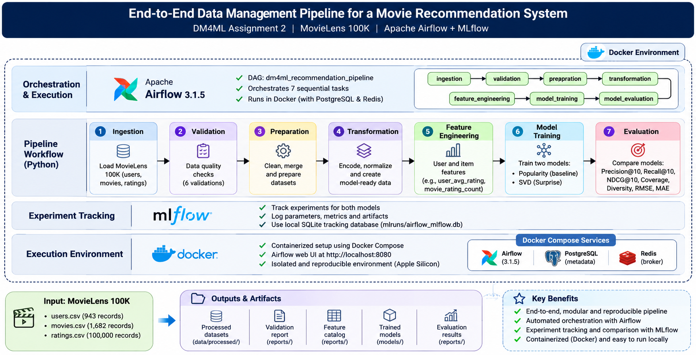
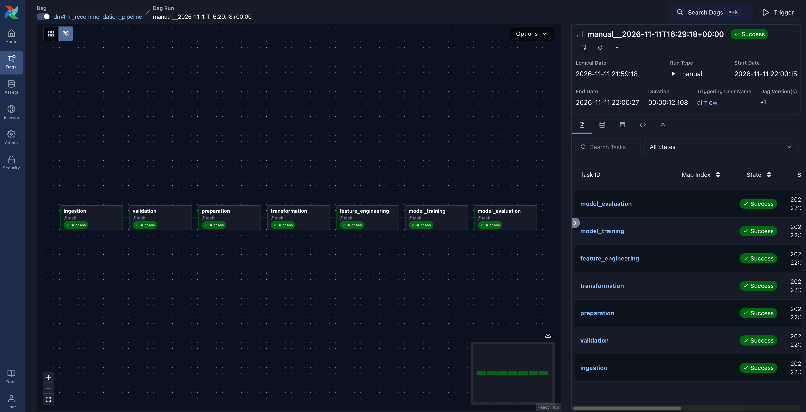
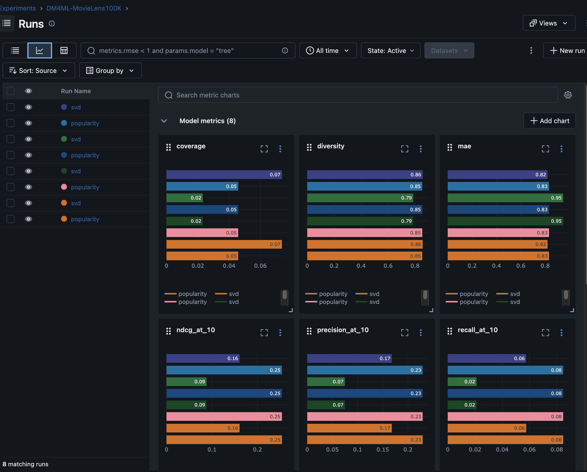

# DM4ML Assignment 2

**End-to-End Data Management Pipeline for a Movie Recommendation System**  
**Roll Number:** 2025AG05482

## 1. About the project

For this assignment, I built a data pipeline for a movie recommendation system using the MovieLens 100K dataset. It downloads the data, checks its quality, prepares it, creates features, trains two models and compares their results.

I used **Docker** to run **Apache Airflow** on my MacBook M4. Airflow runs the seven tasks in order. I used **MLflow** to keep track of model runs and results.

## Pipeline Architecture and Execution Evidence

### Architecture Diagram

The following diagram illustrates the end-to-end MovieLens 100K recommendation pipeline, including its seven processing stages, Apache Airflow orchestration, Docker environment, and MLflow experiment tracking.



### Successful Airflow Execution

The Apache Airflow DAG `dm4ml_recommendation_pipeline` successfully executed all seven pipeline tasks.



### MLflow Experiment Tracking

MLflow was used to track the popularity baseline and Surprise SVD models, including their parameters, evaluation metrics, and artifacts.



## 2. Tools used and how they work together

- **Python, pandas and NumPy:** Data processing and preparation.
- **Surprise SVD:** Personalized recommendation model.
- **Docker Desktop:** Runs the Airflow services in containers.
- **Apache Airflow 3.1.5:** Runs the seven pipeline tasks.
- **MLflow:** Stores model parameters, metrics and run details.
- **GitHub:** Stores the project code and setup files.

**Overall flow:** MovieLens 100K data → Python pipeline (7 stages) → model results and reports. Docker runs Airflow, Airflow controls the task order, and MLflow tracks the model runs.

## 3. Dataset

Dataset: MovieLens 100K  
Source: https://grouplens.org/datasets/movielens/100k/

- **943 users**
- **1,682 movies**
- **100,000 ratings**

The ingestion step creates `data/raw/users.csv`, `data/raw/movies.csv` and `data/raw/ratings.csv`.

## 4. Pipeline steps

1. **Ingestion:** Downloads and loads the MovieLens data.
2. **Validation:** Checks missing required values, duplicates, data types, rating range, timestamps and user/movie references.
3. **Preparation:** Cleans the data and creates training and test files.
4. **Transformation:** Creates user activity, movie popularity and other useful tables.
5. **Feature engineering:** Creates user, movie and interaction features.
6. **Model training:** Trains the Popularity and SVD models.
7. **Model evaluation:** Compares both models using ranking and rating metrics.

Airflow runs these tasks one after another.

## 5. Docker and Airflow setup (Mac M4)

I used Docker because installing Airflow directly on my Mac M4 was giving compatibility issues.

1. Install **Docker Desktop for Mac (Apple Silicon)**: https://docs.docker.com/desktop/setup/install/mac-install/
2. Open Docker Desktop and wait for it to start.
3. I referred to the official Airflow Docker instructions: https://airflow.apache.org/docs/apache-airflow/stable/howto/docker-compose/index.html
4. Open the project folder and go to `airflow-setup/`.
5. The following setup files are included in that folder:
   - `docker-compose.yaml` – Sets up the Airflow services.
   - `Dockerfile` – Builds the Airflow image with the needed packages.
   - `requirements-project.txt` – Lists extra Python packages used by the project.
   - `dags/recommendation_pipeline.py` – Defines the Airflow pipeline.
6. Create a local `.env` file inside `airflow-setup/` containing `AIRFLOW_UID=50000`. Do not commit this file.
7. Open Terminal in the `airflow-setup/` folder and run:

   ```bash
   docker compose up --build -d
   ```

8. Open `http://localhost:8080` in a browser. The provided Compose file defaults to username `airflow` and password `airflow` for local development (unless overridden with `_AIRFLOW_WWW_USER_USERNAME` and `_AIRFLOW_WWW_USER_PASSWORD`). Change these defaults for any non-local deployment.
9. Find the DAG named `dm4ml_recommendation_pipeline`, trigger it and check the Graph View.

**Result:** All seven tasks completed successfully in my run.

> **Note:** Docker Compose includes an `airflow-init` service for database initialization and creating the local admin account. If starting on another machine, check `airflow-setup/docker-compose.yaml`. The `.env` file and generated outputs are intentionally not committed.

## 6. Running the Python pipeline

The main entry file is `main.py`. The Python code for each stage is kept in `src/`. Project dependencies are listed in `requirements.txt`.

From the **project root**, in a compatible Python environment, run:

```bash
python -m pip install -r requirements.txt
python main.py
```

This executes ingestion through evaluation and creates the data, reports, models, and local MLflow tracking files. The first run may download the MovieLens 100K dataset, so internet access may be needed. Airflow runs the same project stages through `airflow-setup/dags/recommendation_pipeline.py`.

## 7. Validation and preparation results

The six main validation checks passed. There were some warnings for optional movie information, including missing release dates and IMDb URLs. The validation results are saved in `reports/validation_report.json`.

I used a **chronological, timestamp-grouped train/test split** to keep earlier ratings in training and later ratings in testing. Ratings sharing the cutoff timestamp were kept together to avoid timestamp overlap.

- **Training ratings:** 79,999
- **Test ratings:** 20,001

The feature details are saved in `data/features/feature_catalog.csv`, and the feature report is in `data/features/feature_report.json`.

## 8. Models and results

I trained two models:

- **Popularity model:** Recommends movies based on their popularity. This is the baseline.
- **SVD model:** Uses past ratings to learn user preferences and make personalized predictions.

The results from `reports/evaluation_comparison.csv` are:

| Metric | Popularity | SVD |
|---|---:|---:|
| Precision@10 | 0.2293 | 0.1679 |
| Recall@10 | 0.0847 | 0.0576 |
| NDCG@10 | 0.2537 | 0.1606 |
| Coverage | 0.0458 | 0.0737 |
| Diversity | 0.8534 | 0.8563 |
| RMSE | 1.0367 | 1.0287 |
| MAE | 0.8314 | 0.8194 |

The Popularity model performed better on Precision@10, Recall@10 and NDCG@10. SVD had higher Coverage, slightly higher Diversity, and lower RMSE and MAE.

## 9. MLflow tracking

I used MLflow to record model parameters, evaluation metrics and model runs. The experiment is named `DM4ML-MovieLens100K`.

The **Airflow Docker run** uses the SQLite tracking database `mlruns/airflow_mlflow.db`. After running the DAG, from the **project root**, start the MLflow UI with:

```bash
mlflow ui --backend-store-uri sqlite:///mlruns/airflow_mlflow.db --port 5000
```

Open `http://localhost:5000` to inspect experiments and runs. This command requires MLflow installed in your local Python environment (`python -m pip install -r requirements.txt`).

**Note:** Running `python main.py` outside Airflow uses `mlruns/mlflow.db` by default, unless `MLFLOW_TRACKING_URI` is set. The command above opens `mlruns/airflow_mlflow.db`, which is used by the Dockerized Airflow pipeline. MLflow databases and generated artifacts are local files, not included in GitHub. A fresh clone will need to run the pipeline to generate its own runs.

## 10. Main project files

| File or folder | Purpose |
|---|---|
| `main.py` | Main Python pipeline |
| `src/` | Code for each pipeline stage |
| `requirements.txt` | Python packages |
| `airflow-setup/docker-compose.yaml` | Docker and Airflow services |
| `airflow-setup/Dockerfile` | Custom Airflow image |
| `airflow-setup/requirements-project.txt` | Extra dependencies for Airflow |
| `airflow-setup/dags/recommendation_pipeline.py` | Airflow DAG |
| `reports/` | Validation, ingestion and evaluation reports |
| `data/features/feature_catalog.csv` | Feature names and descriptions |
| `docs/DM4ML_Pipeline_Architecture.png` | End-to-end pipeline architecture diagram |
| `docs/airflow_success.png` | Screenshot of successful Airflow execution |
| `docs/mlflow_experiment.png` | MLflow experiment tracking screenshot |

The downloaded data, trained model files, MLflow database and runtime logs are generated locally and are not uploaded to GitHub.

## 11. Reproducing and checking the results

After running the pipeline, check `reports/ingestion_report.json`, `reports/validation_report.json`, `reports/model_training_report.json`, and `reports/evaluation_comparison.csv`. The feature definitions are in `data/features/feature_catalog.csv`. For the Airflow run, check that all seven tasks are successful in Graph View. The screenshots in `docs/` document the execution performed for this assignment; newly generated results may differ if dependencies or settings change.

## 12. Final result

I was able to run the full pipeline in Airflow using Docker. All seven tasks completed successfully. Both models were trained and evaluated, and I compared their results using MLflow and the saved reports.

The assignment report contains more details and screenshots of the Airflow run and MLflow results.
